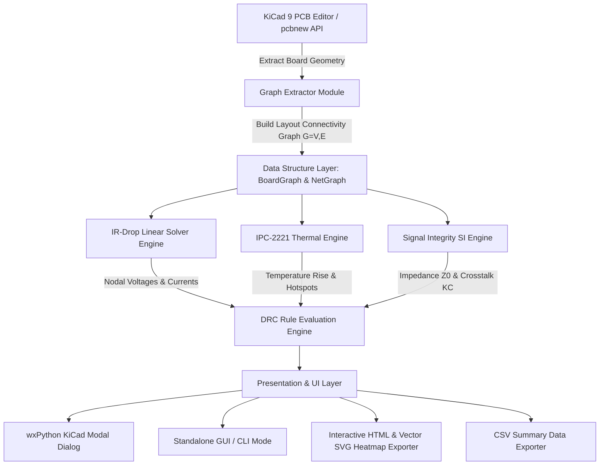
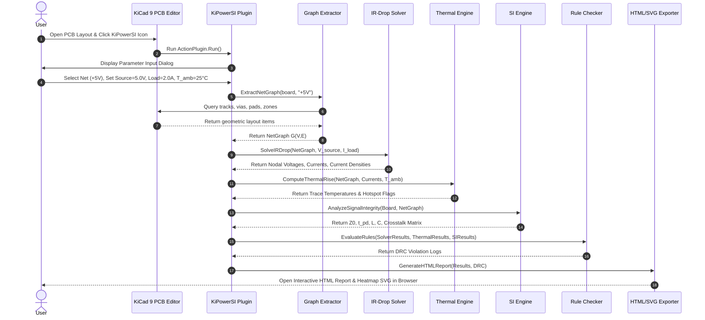

# Architecture & Design Document: KiPowerSI Pro
## Intelligent Power Distribution Network (PDN), IR-Drop & Thermal Parasitics Analyzer for KiCad 9

---

## 1. System Overview & Objectives

**KiPowerSI Pro** is an open-source, automated KiCad 9 action plugin that performs static Power Distribution Network (PDN) DC IR-drop calculation, trace thermal hotspot detection, and transmission line signal integrity estimation directly inside the KiCad PCB Editor (`pcbnew`).

### Core Objectives
1. **Automation**: Eliminate manual parasitic calculation by automatically parsing track geometry, layer stackups, via arrays, and component pads directly from KiCad 9 board files.
2. **Multi-Physics Simulation**:
   - **Electrical**: Solve nodal voltage distributions, branch currents, and local current densities ($J$ in $\text{A/mm}^2$).
   - **Thermal**: Compute IPC-2221 trace temperature rise ($\Delta T$) and flag localized Joule heating hotspots ($I^2R$).
   - **Signal Integrity**: Estimate microstrip/stripline characteristic impedance ($Z_0$), propagation delay ($t_{pd}$), loop parasitics ($L, C$), and crosstalk coupling coefficients ($K_C$).
3. **Cross-Platform Compatibility**: Full support for KiCad 9 on Windows, Linux, and macOS, with dual-mode execution (native wxPython KiCad GUI modal window + standalone CLI/Tkinter application).

---

## 2. High-Level Architecture

The software follows a **Layered Model-View-Controller (MVC)** architectural pattern, enforcing strict separation between KiCad API bindings, core numerical engines, data models, rule checkers, and presentation interfaces.

---

## 3. Module Breakdown & System Interfaces

| Module File | Component Name | Responsibility / Key Logic |
| :--- | :--- | :--- |
| [`kipowersi/plugin.py`](kipowersi/plugin.py) | **Plugin Entrypoint** | Implements `pcbnew.ActionPlugin`. Handles KiCad menu registration, toolbar icon integration, and plugin lifecycle. |
| [`kipowersi/gui.py`](kipowersi/gui.py) | **User Interface Manager** | Implements wxPython modal dialog inside KiCad 9, with input fields for voltage source, load current, thermal limits, and layer copper thickness. Includes Tkinter fallback for standalone execution. |
| [`kipowersi/graph_extractor.py`](kipowersi/graph_extractor.py) | **Spatial Graph Extractor** | Iterates over `pcbnew.BOARD` items (`TRACK`, `VIA`, `PAD`, `ZONE`). Constructs a geometric connectivity graph $G=(V,E)$ for selected electrical nets. |
| [`kipowersi/ir_drop_solver.py`](kipowersi/ir_drop_solver.py) | **Nodal Resistance Matrix Solver** | Assembles conductance matrix $G_{nodal} \cdot V = I$. Computes branch current $I_{ij}$, voltage drop $\Delta V_{ij}$, trace resistance $R_{ij}$, and current density $J_{ij}$. |
| [`kipowersi/thermal_engine.py`](kipowersi/thermal_engine.py) | **IPC-2221 Thermal Engine** | Evaluates thermal heating equations for internal and external PCB layers. Determines localized temperature rise $\Delta T$ and thermal risk ratings. |
| [`kipowersi/signal_integrity.py`](kipowersi/signal_integrity.py) | **Transmission Line & SI Engine** | Computes microstrip/stripline characteristic impedance ($Z_0$), propagation delay ($t_{pd}$), loop inductance ($L$), trace capacitance ($C$), and capacitive crosstalk ($K_C$). |
| [`kipowersi/drc_rules.py`](kipowersi/drc_rules.py) | **PDN & SI Rule Checker** | Evaluates solver outputs against configurable DRC constraints (Max IR-drop %, Max Current Density $A/mm^2$, Max $\Delta T$, $Z_0$ tolerance). |
| [`kipowersi/report_generator.py`](kipowersi/report_generator.py) | **Report & Heatmap Generator** | Renders self-contained interactive HTML reports with embedded CSS styling, vector SVG thermal heatmaps, and CSV exports. |

---

## 4. Graph Data Structure & Geometry Modeling

The KiCad layout geometry is abstracted as a directed graph $G = (V, E)$:

### Vertices ($V$)
Each vertex $v_i \in V$ represents a physical contact point or geometry junction:
- **Pad Nodes**: Component pin pads with specified net names and coordinate position $(x_i, y_i, z_i)$.
- **Via Nodes**: Layer transition points interconnecting top, inner, and bottom layers.
- **Junction Nodes**: Intersections between two or more track segments on the same layer.

### Edges ($E$)
Each edge $e_{ij} = (v_i, v_j) \in E$ represents a physical copper trace segment or via cylinder with calculated resistance $R_{ij}$:
$$R_{ij} = \rho(T) \cdot \frac{L_{ij}}{w_{ij} \cdot t_{layer}}$$

Where:
- $\rho(T) = \rho_{Cu,20^\circ C} \cdot [1 + \alpha (T_{ambient} - 20)]$ is temperature-adjusted copper resistivity ($\rho_{Cu,20} = 1.72 \times 10^{-8} \, \Omega\cdot\text{m}$, $\alpha = 0.00393 / \text{°C}$).
- $L_{ij}$ is the Euclidean length of the segment in millimeters.
- $w_{ij}$ is the track width in millimeters.
- $t_{layer}$ is the copper foil thickness (e.g., 1 oz/ft² = $0.035 \text{ mm}$).

---

## 5. Mathematical Formulations

### 5.1 Nodal DC IR-Drop Conductance Matrix Formulation
Applying Kirchhoff's Current Law (KCL) at every interior node $i \in V$:
$$\sum_{j \in N(i)} G_{ij} (V_i - V_j) = I_{ext, i}$$

Where:
- $G_{ij} = \frac{1}{R_{ij}}$ is the branch conductance between node $i$ and node $j$.
- $V_i, V_j$ are unknown nodal electrical potentials.
- $I_{ext, i}$ is external injected or drawn current ($I_{ext, i} = +I_{source}$ at power source pad, $I_{ext, i} = -I_{load}$ at sink pad, and $0$ at intermediate junctions).

This yields the global system of linear equations:
$$\mathbf{G} \cdot \mathbf{V} = \mathbf{I}$$

Where $\mathbf{G}$ is a symmetric, positive-definite $N \times N$ conductance matrix. To solve for node potentials $\mathbf{V}$, ground nodes are fixed to $0\text{ V}$ reference, and matrix decomposition (LU factorization / SciPy linear solver) is applied:
$$\mathbf{V} = \mathbf{G}^{-1} \mathbf{I}$$

Branch current density $J_{ij}$ is subsequently calculated as:
$$J_{ij} = \frac{I_{ij}}{A_{ij}} = \frac{|V_i - V_j|}{R_{ij} \cdot (w_{ij} \cdot t_{layer})} \quad [\text{A/mm}^2]$$

---

### 5.2 IPC-2221 Trace Thermal Equations
Trace temperature rise ($\Delta T$ in $\text{°C}$) under RMS current loading is computed per IPC-2221A standard:
$$I = k \cdot \Delta T^{0.44} \cdot A^{0.725}$$

Solving for temperature rise $\Delta T$:
$$\Delta T = \left( \frac{I}{k \cdot A^{0.725}} \right)^{\frac{1}{0.44}} = \left( \frac{I}{k \cdot A^{0.725}} \right)^{2.273}$$

Where:
- $I$ is branch RMS current in Amperes.
- $A$ is cross-sectional trace area in $\text{mil}^2$ ($1 \text{ mm}^2 = 1550 \text{ mil}^2$).
- $k = 0.048$ for external layers (higher convective heat dissipation).
- $k = 0.024$ for internal layers (encapsulated in FR4 dielectric).

Final steady-state trace temperature:
$$T_{trace} = T_{ambient} + \Delta T$$

---

### 5.3 Signal Integrity Parasitic Extraction

#### Surface Microstrip Transmission Line
For a signal track of width $w$ routed over a ground plane at height $h$ with dielectric constant $\varepsilon_r$ (FR4 $\approx 4.3$):
$$Z_0 = \frac{87}{\sqrt{\varepsilon_r + 1.41}} \cdot \ln \left( \frac{5.98 \cdot h}{0.8 \cdot w + t} \right) \quad [\Omega]$$

Propagation Delay ($t_{pd}$):
$$t_{pd} = 3.333 \cdot \sqrt{0.475 \cdot \varepsilon_r + 0.67} \quad [\text{ns/m}]$$

Per-Unit-Length Capacitance ($C$) and Inductance ($L$):
$$C = \frac{t_{pd}}{Z_0} \quad [\text{pF/m}], \qquad L = t_{pd} \cdot Z_0 \quad [\text{nH/m}]$$

#### Capacitive Crosstalk Coupling Coefficient ($K_C$)
For parallel trace segments of separation distance $s$ and length $L_{parallel}$:
$$K_C = \frac{1}{1 + \left( \frac{s}{h} \right)^2}$$

---

## 6. Sequence Diagram: Execution & Data Flow

---

## 7. Software Extensibility & Future Roadmap

During the eSim internship at IIT Bombay, **KiPowerSI Pro** can be expanded in several high-impact directions:

1. **2D Finite Element Method (FEM) Mesh Solver**: Upgrade trace segment nodal solver to a full 2D Delaunay triangular mesh solver for irregular copper plane zones.
2. **AC Frequency-Domain Target Impedance Analysis**: Compute $Z(f)$ across frequency range ($1\text{ kHz} - 1\text{ GHz}$) including Decoupling Capacitor ESL/ESR antiresonances.
3. **Thermal-Electrical Co-Simulation Loop**: Iteratively recalculate copper resistance $R(T)$ as temperature increases, simulating true thermal runaway equilibrium.
4. **Direct eSim / Ngspice Netlist Export**: Export generated PDN parasitic sub-circuits directly into eSim for SPICE transient co-simulation.
